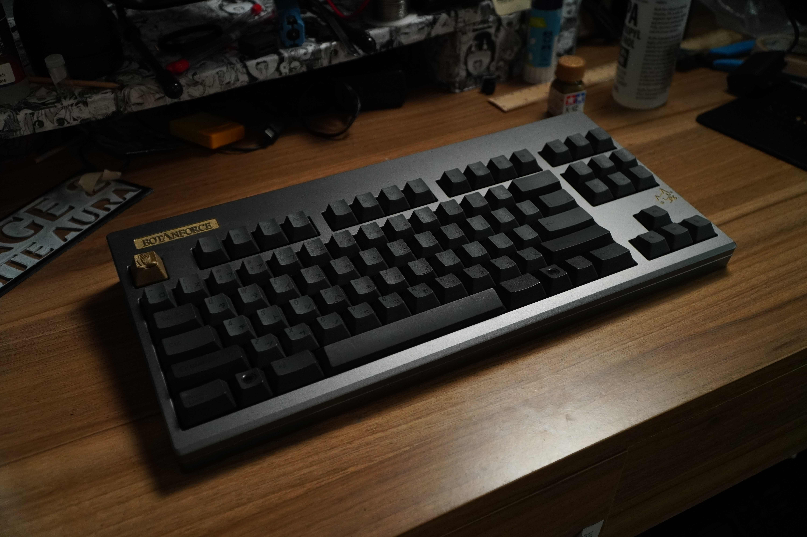
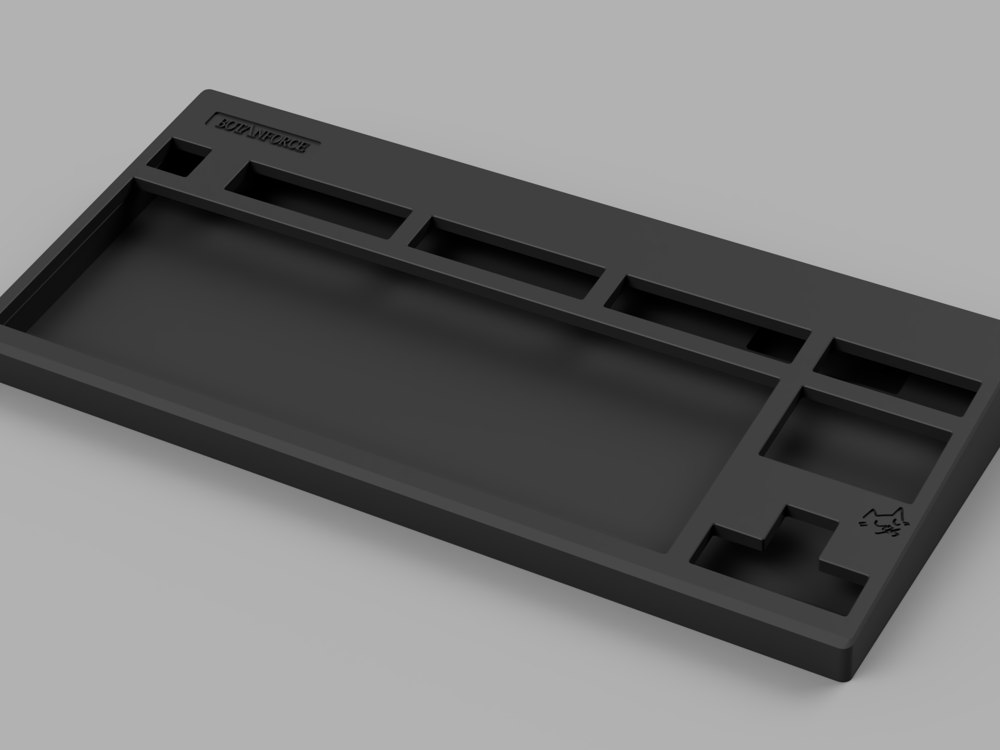
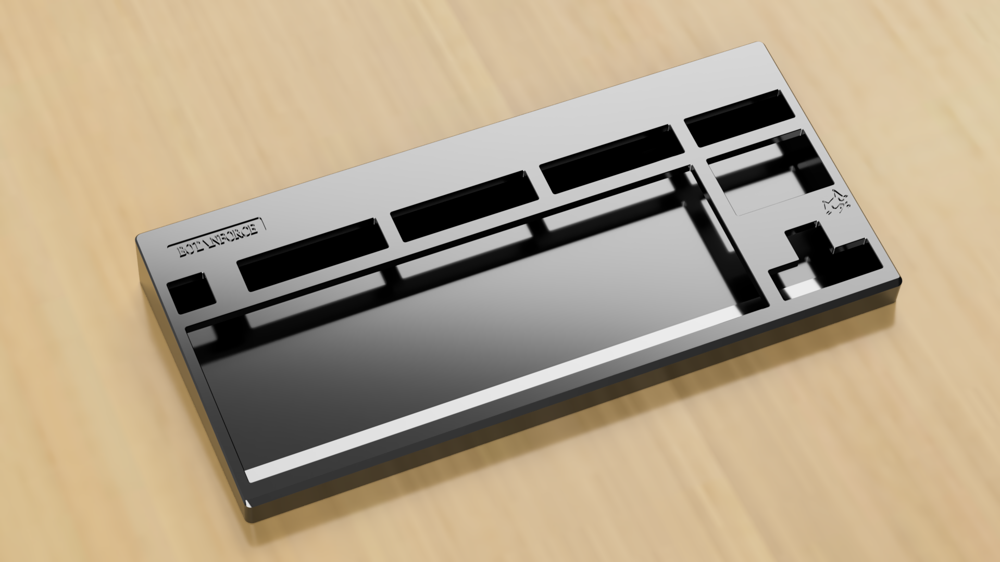
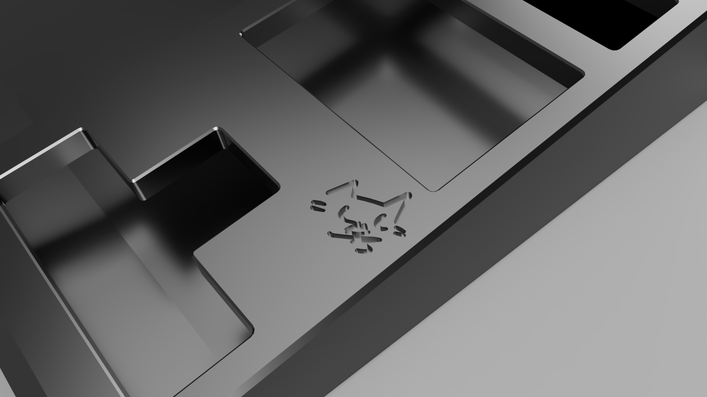
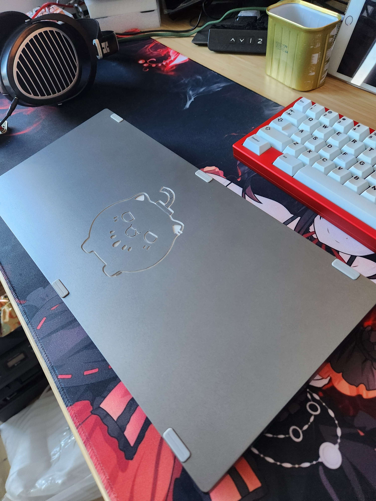
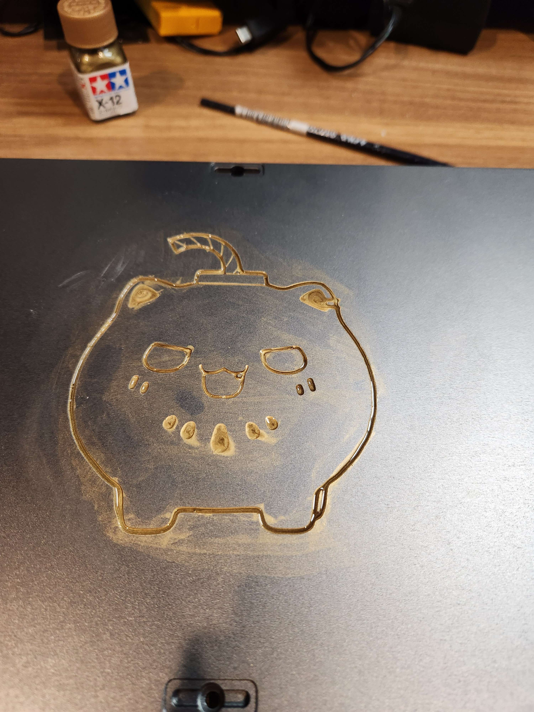
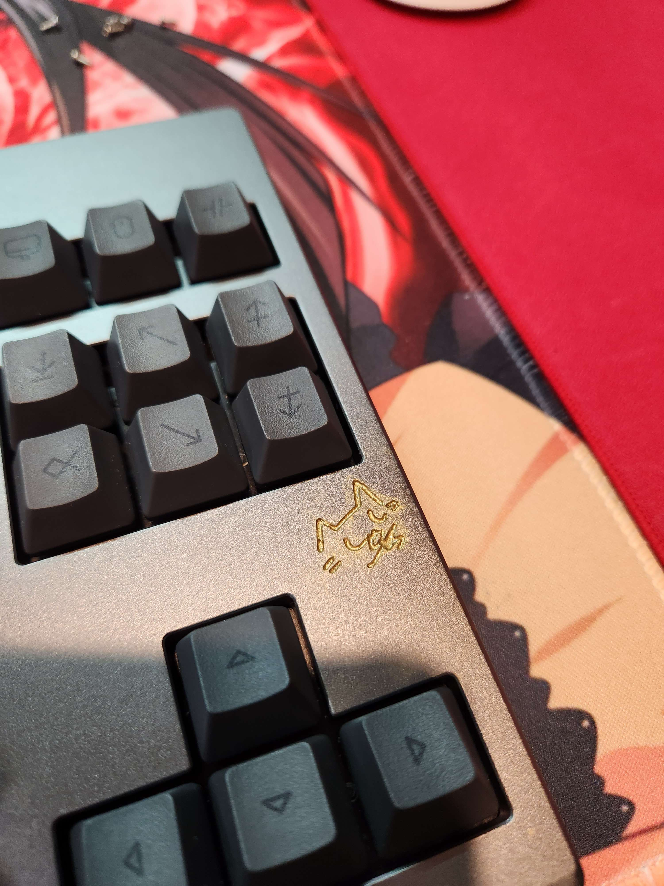

# 🐱 BOTANFORCE

> *"A one-off Realforce R2 TKL aluminium case, CNC-machined and anodized — themed after* ***Sishiro Botan***."

<p align="center">
  
</p>

---

## ⚙️ Specs

| | |
|---|---|
| **Layout** | Realforce R2 TKL (87-key) |
| **Type** | One-off — a single case, not for sale |
| **Case** | CNC-machined 6061 aluminium, anodized |
| **Colorway** | Dark grey anodized case with gold-painted engravings |
| **Design base** | Modeled after the Realforce R2 case (Norbauer design style) |
| **Emblems** | Sashimi-chan (Sishiro Botan's cat) — engraved on the bottom plate & a small cat mark on the top |
| **Plate** | Stock Realforce R2 TKL plate — no screws to the case, just sandwiched between the case |
| **Assembly** | 6 screws; the aluminium plate is bolt-free |
| **Daughterboard** | Custom USB-C daughterboard for the Realforce R2 |
| **Feet** | Geon rectangle silicone feet — cover the screw holes |
| **Sound profile** | Muted "toki" sound — aluminium plate + aluminium case |
| **Sourced from** | Alibaba supplier (China) |

---

## 🐱 The Design

The design is a love letter to **Sishiro Botan** and her cat, Sashimi-chan. The case is a CNC-machined 6061 aluminium Realforce R2 TKL case, anodized dark grey, with the "BOTANFORCE" nameplate engraved on the top and **Sashimi-chan** engraved onto the bottom plate. The engravings were painted gold by hand as a finishing touch.

The design was modeled in 3D and rendered in May 2023.

### Bottom plate — render

<p align="center">
  
</p>

<details>
<summary>Top view — desk render</summary>
<p align="center"></p>
</details>

<details>
<summary>Sashimi-chan engraving — close-up</summary>
<p align="center"></p>
</details>

---

## 🔨 The Build

- **May 11, 2023** — the prototype was ordered. Estimated cost: ~3.2 million IDR (case only, no PCB or plate — the plate is aluminium and bolt-free). The design follows the Norbauer design style, based on the Realforce R2.
- **May 15, 2023** — the prototype arrived. First look, then a test fit.
- **May 17, 2023** — the board was assembled: 6 screws, no plate bolts. Soundtest: the aluminium plate + aluminium case gives a muted "toki" sound profile.
- **May 17, 2023** — the engravings (Sashimi-chan on the bottom, the cat mark on the top) were painted gold by hand.

---

## 📷 The Result

<p align="center">
  
</p>

<p align="center">
  
</p>

<p align="center">
  
</p>

<p align="center">
  
</p>

---

## 📁 Repository Structure

```
botanforce/
├── README.md
└── images/
    ├── design/
    │   ├── 01-bottom-plate.png            # Bottom plate render — nameplate + cat engraving
    │   ├── 02-bottom-plate-desk.png       # Top view desk render
    │   └── 03-bottom-cat-engraving.png    # Sashimi-chan engraving close-up (render)
    └── final/
        ├── 01-assembled-desk.jpg          # Assembled board on the desk (May 15, 2023)
        ├── 02-bottom-plate-cat.jpg        # Bottom plate with engraved Sashimi-chan
        ├── 03-bottom-cat-gold-paint.jpg   # Sashimi-chan engraving painted gold
        ├── 04-top-cat-mark-gold.jpg       # Small cat mark on the top plate, painted gold
        └── 05-desk-angle.jpg             # Desk angle — gold nameplate and cat mark
```

---

*Built by [ReinTanto](https://github.com/ReinTanto). A one-off — no group buy, no for-sale.* 🐱
